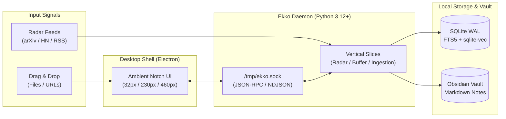

<h1 align="center">
  <sub></sub> Ekko
</h1>

<p align="center">
  <strong>Ambient cognitive buffer and blindspot sentinel docked to your desktop panel.</strong>
</p>

<p align="center">
  <a href="#introduction">Introduction</a> &middot;
  <a href="#features">Features</a> &middot;
  <a href="#tech-stack">Tech Stack</a> &middot;
  <a href="#architecture">Architecture</a> &middot;
  <a href="#quickstart">Quickstart</a> &middot;
  <a href="#documentation">Documentation</a> &middot;
  <a href="#license">License</a>
</p>

<p align="center">
  <a href="LICENSE"></a>
  <a href="CHANGELOG.md"></a>
  
  
  
</p>

---

## Introduction

**Ekko** is a local-first, distraction-free ambient cognitive buffer and blind-spot watch sentinel docked directly beneath your operating system's top panel (Linux, macOS, Windows).

Engineered around a radical ergonomic constraint: **every interaction must complete in under 3 seconds**.

- **Drop & Forget In-Place**: Absorb documents, code snippets, and links instantly without leaving your current workspace or switching windows.
- **Rapid Radar Triage**: Sift through anomalies and high-value technical signals curated silently in the background with a single keystroke or click.
- **Frictionless Obsidian Export**: Query distilled atomic notes with sub-millisecond hybrid retrieval and save them directly into your Obsidian markdown vault.

---

## Features

- **Ambient Notch Dock**: Organically anchored beneath your desktop panel with host OS color blending (`--notch-anchor`) and seamless concave fillets. Adapts across 3 geometry states: Mini-Capsule (`32px`), Compact (`230px`), and Extended (`460px`).
- **Drop & Forget In-Place**: Drag and drop any file or URL into the notch. Ekko compresses and distills content into atomic notes in seconds with zero layout jank.
- **Radar Blindspot Watch**: Autonomous background sentinel monitoring selected technical sources (arXiv, HackerNews, RSS, REST) and distilling them into actionable briefing cards.
- **Ephemeral Staging Buffer**: Instant-access memory workbench featuring sub-millisecond hybrid retrieval (FTS5 BM25 + dense vector similarity) and native Obsidian Markdown compatibility.
- **100% Local-First & Zero-Cloud**: Self-contained SQLite WAL engine, on-device vector embeddings (`sqlite-vec`), and local LLM distillation (Ollama `qwen2.5:7b` or private endpoints) with zero telemetry and zero external tracking.

---

## Tech Stack

| Layer | Technology | Description |
|---|---|---|
| **Desktop Shell** | [Electron](https://www.electronjs.org/) | Frameless, transparent, top-docked window orchestration and system integration |
| **Frontend UI** | [React 19](https://react.dev/) &bull; [TypeScript](https://www.typescriptlang.org/) | Declarative component architecture and strict static typing |
| **Styling & Motion** | [Tailwind CSS](https://tailwindcss.com/) &bull; [Framer Motion](https://www.framer.com/motion/) | OLED dark mode tokens and hardware-accelerated spring physics |
| **Backend Daemon** | [Python 3.12+](https://www.python.org/) &bull; [uv](https://docs.astral.sh/uv/) | Asynchronous vertical slices daemon communicating over `/tmp/ekko.sock` |
| **Relational Storage** | [SQLite](https://www.sqlite.org/) (WAL Mode) | Local-first persistence with transactional write-ahead logging |
| **Lexical Search** | [FTS5 BM25](https://www.sqlite.org/fts5.html) | Native full-text search indexing title, tags, content, and summaries |
| **Vector Search** | [sqlite-vec](https://github.com/asg017/sqlite-vec) &bull; [FastEmbed](https://github.com/qdrant/fastembed) | In-process dense vector embeddings and cosine similarity search |
| **LLM Distillation** | [LiteLLM](https://github.com/BerriAI/litellm) | Local inference via Ollama (`qwen2.5:7b`) or private API endpoints |

---

## Architecture

Ekko decouples presentation from daemon workloads via a high-performance local UNIX domain socket protocol:



For full details on the IPC contract, state machines, and hybrid retrieval, see the [System Architecture Specification](docs/architecture.md).

---

## Quickstart

### Recommended Versions

| Prerequisite | Recommended Version | Verification Command |
|---|---|---|
| **Python** | `>= 3.12` | `python3 --version` |
| **Node.js** | `>= 20.x` | `node --version` |
| **uv** | `>= 0.4.x` | `uv --version` |

### Installation & Launch

```bash
# 1. Clone the repository and enter the directory
git clone https://github.com/Moohmoo/Ekko.git && cd Ekko

# 2. Install all frontend and backend dependencies
make install

# 3. Launch the desktop application and background daemon
make dev
```

### Verification & Tests

```bash
# Run the full automated verification suite (Pytest & Playwright E2E)
make test
```

---

## Documentation

In-depth technical specifications and architectural decision records are organized within [`docs/`](./docs/):

- **[System Architecture](./docs/architecture.md)** – Full-stack IPC contract, vertical slices, and hybrid search engine.
- **[Design System](./docs/design-system.md)** – OLED palette, responsive notch geometry, and mascot motion physics.
- **[Architecture Decision Records (ADRs)](./docs/adr/README.md)** – Foundational technical decisions and trade-offs.

---

## License

This project is licensed under the [MIT License](LICENSE).
