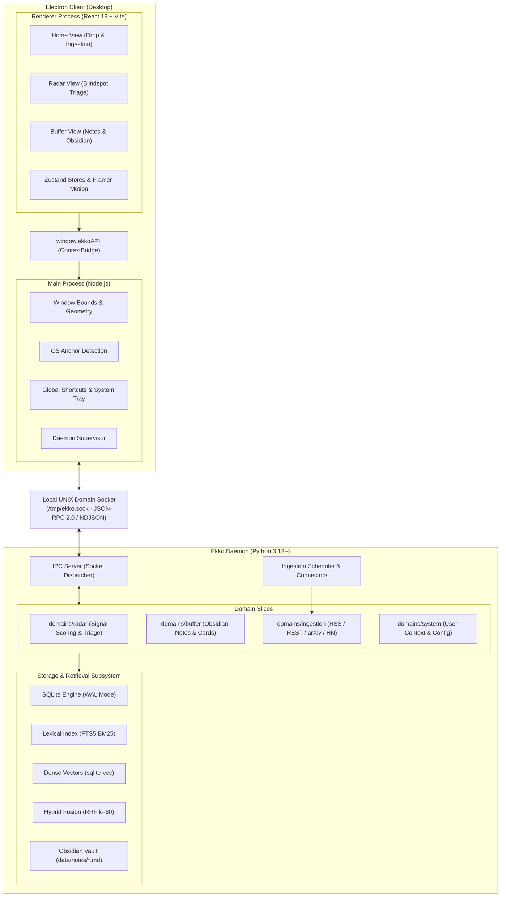

# System Architecture

Ekko is an ambient cognitive buffer and blind-spot watch sentinel docked directly beneath the host operating system's top panel. It is engineered around a single ergonomic rule: **all interactions must complete in under 3 seconds**.

---

## 1. System Topology

The application is architected into two decoupled tiers communicating over a dedicated local UNIX domain socket using JSON-RPC 2.0 and NDJSON streaming:

---

## 2. Window Geometry & Lifecycle

Ekko operates as a frameless, transparent, top-docked window (`resizable: false`, `alwaysOnTop: true`). Its geometry adapts dynamically across three discrete states:

| State | Width | Height | Stage Layout & Components | Interaction & Ergonomics |
|---|---|---|---|---|
| **Mini-Capsule** | 130 px | 32 px | Mascot slot (`w-6 h-6`), unread alert dot, chevron indicator | Desktop click targets unimpeded; click or drag-over expands to Compact |
| **Compact Notch** | 660 px | 230 px | PodHeader (32px) + Stage (178px): Bento drop zone, reactive mascot (`w-24 h-24`), last note or Radar signal card | Default interaction mode; rapid drag-and-drop & one-click signal triage (< 3s) |
| **Extended Notch** | 660 px | 460 px | PodHeader (32px) + Stage (408px): Buffer note browser, hybrid search bar, Obsidian viewer, or Settings panel | Deep exploration and configuration; invoked on tab click or hotkey |

### Transition & Curtain Orchestration
- **Expansion (32px -> 230/460px)**: The native Electron window expands immediately via `win.setBounds()`, followed by an unrolling curtain animation rendered by Framer Motion.
- **Collapse (230/460px -> 32px)**: The visual container contracts upward into the capsule shape; `win.setBounds()` is called only after animation completion to prevent desktop clipping.
- **Sentinel Lifecycle**: Pressing `Escape` or clicking `[ ✕ ]` hides the window (`win.hide()`) rather than destroying it, preserving UI state and ensuring instant re-display on hotkey invocation.

---

## 3. Storage & Retrieval Subsystem

The storage architecture is strictly **local-first** and self-contained within a single SQLite database (`data/ekko.db`):

1. **Transaction Engine**:
   - SQLite running in Write-Ahead Logging (`WAL`) mode with `synchronous = NORMAL` and 60-second busy timeouts.
2. **Lexical Retrieval**:
   - SQLite FTS5 virtual table indexing note content, title, tags, and summary with BM25 ranking.
3. **Semantic Retrieval**:
   - Vector embeddings generated locally via FastEmbed (`BAAI/bge-small-en-v1.5` / `bge-small-zh-v1.5`), indexed using the native `sqlite-vec` extension with cosine distance.
4. **Hybrid Rank Fusion (RRF)**:
   - Queries execute against both lexical and vector indices concurrently.
   - Results are unified using Reciprocal Rank Fusion:
     $$\text{RRF Score}(d) = \sum_{m \in \{\text{lexical}, \text{vector}\}} \frac{1}{k + r_m(d)} \quad (k = 60)$$
   - Produces balanced rankings resilient to vocabulary mismatch without requiring external vector databases.
5. **Obsidian Compatibility**:
   - Distilled notes persist as standard Markdown files (`data/notes/*.md`) with complete YAML frontmatter (ID, source, timestamp, tags, summary).

---

## 4. Backend Vertical Slices

The Python daemon (`src/ekko/`) is structured into decoupled domain slices:

- **`domains/radar/`**: Blindspot signals, alert scoring, and background triage watch box.
- **`domains/buffer/`**: Distilled note cards, staging buffer, and Obsidian Markdown vault persistence.
- **`domains/ingestion/`**: Declarative polling connectors for RSS, REST, arXiv, and HackerNews with rate-limiting, jitter, and heuristic content extraction.
- **`domains/system/`**: User context, profile configuration, and YAML settings loader.
- **`db/`**: Schema migrations, transactional WAL connections, lexical indexing (FTS5 BM25), dense vector embeddings (`sqlite-vec`), and Reciprocal Rank Fusion (RRF $k=60$).
- **`daemon/`**: UNIX domain socket server (`/tmp/ekko.sock`), client RPC dispatcher, process supervisor, and resource confinement (process niceness incremented by +10 to ensure zero impact on foreground desktop tasks).
