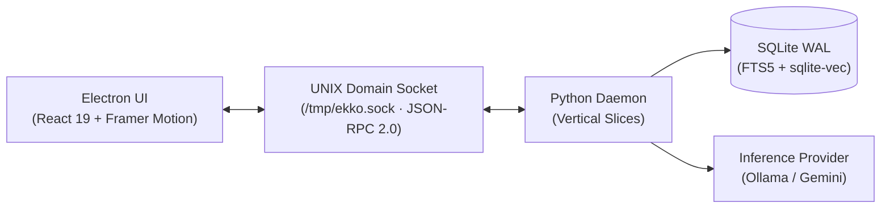

# System Architecture

Ekko is a local-first ambient cognitive buffer and blind-spot watch sentinel docked directly beneath the host operating system's top panel. It captures incoming documents, monitors technical sources in the background, and distills knowledge into an Obsidian-compatible vault—designed so every interaction finishes in under 3 seconds.

---

## 1. System Topology

The desktop application is decoupled into two processes communicating over a local UNIX domain socket:

- **Electron UI (Frontend)**: Frameless desktop shell docked under the system bar, managing window bounds, drag-and-drop events, and mascot animations.
- **Python Daemon (Backend)**: Background service handling ingestion pipelines, scheduled polling, local embedding, and note distillation.
- **UNIX Domain Socket**: Fast, secure inter-process communication using standard JSON-RPC 2.0 and NDJSON token streaming without opening TCP ports.

---

## 2. Window Geometry & Interaction States

Ekko adapts dynamically across three discrete heights while anchored to the desktop top panel:

| State | Dimensions | Key Purpose & Content | Interaction |
|---|---|---|---|
| **Capsule** | 130 × 32 px | Ambient presence, miniature mascot, unread alert dot | Unobtrusive; click or drag-over expands to Compact |
| **Compact** | 660 × 230 px | Drag-and-drop drop zone, active mascot, radar alert card | Default interaction mode; rapid drop & triage (< 3s) |
| **Extended** | 660 × 460 px | Ephemeral buffer note list, hybrid search bar, settings | Deep exploration, search, and configuration |

- **Zero Top Border**: The notch joins directly to the OS status bar with no top border or top corner radius, blending seamlessly with the host theme.
- **Sentinel Lifecycle**: Pressing `Escape` or clicking close hides the window rather than terminating the process, preserving state for instant re-invocation.

---

## 3. Backend Domain Slices

The Python daemon (`src/ekko/`) is structured into decoupled vertical slices centered on business capabilities:

- **`domains/radar`**: Monitors external signals (arXiv, HackerNews, RSS) and scores them for anomalies and blind spots.
- **`domains/buffer`**: Manages distilled knowledge notes, staging cards, and Markdown file persistence for Obsidian vaults.
- **`domains/ingestion`**: Handles connector polling, URL fetching, content extraction, and text compression.
- **`domains/system`**: Manages user context profile, YAML configuration loaders, and system status queries.
- **`db`**: Manages SQLite connections (WAL mode), schema migrations, and search indexing.
- **`daemon`**: Oversees the UNIX socket server, RPC method dispatch, and background task scheduling.

---

## 4. Hybrid Search Engine

To find notes quickly and reliably, Ekko combines lexical and semantic search in a single SQLite database:

1. **Keyword Search (FTS5 BM25)**: Matches exact phrases, terms, code snippets, and tags.
2. **Semantic Similarity (sqlite-vec)**: Compares dense vector embeddings (generated locally with FastEmbed) to surface concepts described with different wording.
3. **Rank Fusion**: Combines both result lists into a single ranked list using Reciprocal Rank Fusion (RRF), ensuring top results are relevant whether searched by exact keyword or conceptual intent.
4. **Obsidian Output**: Notes are written as standard Markdown files (`data/notes/*.md`) with YAML frontmatter, fully usable in any Obsidian vault.
